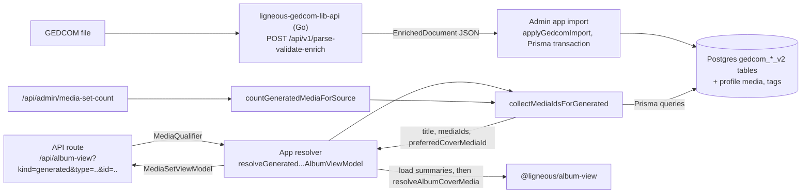

# Architecture: @ligneous/album-generated-queries

## Summary

A generated album has no row of its own. It is defined by one record in the tree (a person, family, event, place, date, note or app tag), and its members are whatever media the GEDCOM links attach to that record. This package holds the Prisma queries that turn such a definition into three things: a list of media ids, a readable title and an optional preferred cover. The public site and the admin app both call it, so the same album has the same contents and title in both. Every query is scoped to one tree by `fileUuid`.

## Data flow

The admin app (the-gonsalves-family-admin, private) sends uploaded GEDCOM files to [ligneous-gedcom-lib-api](https://github.com/lesfleursdelanuitdev/ligneous-gedcom-lib-api), which runs the [ligneous-gedcom-lib](https://github.com/lesfleursdelanuitdev/ligneous-gedcom-lib) parser and enricher. It writes the returned `EnrichedDocument` into the `gedcom_*_v2` tables through the shared Prisma client (ligneous-prisma, private). This package reads those tables. Other callers are the public site's album resolver and the media routes for person and family pages in the-gonsalves-family (private).

## Files

| Path | Responsibility |
| --- | --- |
| `src/collect-media-ids-for-generated.ts` | `collectMediaIdsForGenerated`: one `switch` branch per source type |
| `src/count-generated-media.ts` | `countGeneratedMediaForSource`: same rules, returns a number |
| `src/event-photo-title.ts` | Event titles (`Media from the marriage of X and Y`), `familyPairLabel`, `individualLabel` |
| `src/family-photo-title.ts` | Family titles from the spouses' GEDCOM surnames |
| `src/date-photo-title.ts` | Date titles (`the 1890s`, `March 1891`, `1890–1910`) |
| `src/gedcom-mini.ts` | Strip slashes from GEDCOM names, labels for event tags |

## How each source is collected

| Source | Media ids | Preferred cover |
| --- | --- | --- |
| `individual` | `gedcomIndividualMedia` rows for the person | `gedcomIndividualProfileMedia` |
| `family` | `gedcomFamilyMedia` rows | `gedcomFamilyProfileMedia` |
| `event` | `gedcomEventMedia` rows | `gedcomEventProfileMedia` |
| `place` | `gedcomMediaPlace` rows, plus media of every event whose `placeId` matches | none |
| `date` | `gedcomMediaDate` rows, plus media of every event whose `dateId` matches | none |
| `tag` | `gedcomMediaAppTag` rows whose media is in this tree | `tagProfileMedia` for this tag and tree |
| `note` | Media of every person, family, event and source that carries the note | none |

Independent lookups run in parallel with `Promise.all`. `mergeMediaIds` removes duplicates with a `Set` and keeps insertion order, so a profile image, when set, is the first id. The caller loads `MediaSummary` rows for the ids and passes `preferredCoverMediaId` to `resolveAlbumCoverMedia` in [@ligneous/album-view](https://github.com/lesfleursdelanuitdev/ligneous-album-view). That function uses the profile image if it is in the set and otherwise picks a stable raster image keyed by `JSON.stringify(source)`.

Titles are written in the same style for every type ("Media for", "Media from", "Media tagged"). Event titles map GEDCOM tags to phrases (`MARR` to "the marriage", `BAPM` to "the baptism") and name the couple or the person from the first linked family or individual. A custom `EVEN` uses its own type text. Family titles use the shared surname when both spouses have the same one, else both names. Note titles use the first line of the note, cut at 56 characters.

## Design decisions

| Choice | Cost | Why |
| --- | --- | --- |
| Generated albums are computed on every request | Repeated queries; nothing is cached | No stored copy to keep in sync after a GEDCOM re-import or an edit |
| Takes the `PrismaClient` as an argument | Callers must pass their own client | Each app keeps its own connection pool and auth checks |
| Place and date sets include media of events held there or then | Larger sets than the direct links alone | Event media is linked to the event row, not to its place or date, so direct links alone would miss it |
| Count reuses the collector | Same number of queries as a full collect, plus one `count` | One set of membership rules, no drift between badge and album |
| `album` excluded in the type signature | Callers must branch on curated vs generated first | Curated members live in a junction table the apps already query |

## Testing

There are no tests, no `tsconfig.json` and no `scripts` in `package.json`. The package also cannot type-check on its own, because `@ligneous/prisma` is a private sibling package. The title helpers are pure functions and could be tested without a database. The collectors need a seeded test database.

## Known limitations

- No tests, as above.
- The `note` source runs one query per linked record. A note attached to hundreds of records sends hundreds of queries.
- Event titles use only the first linked family or individual (`take: 1`).
- `place`, `date` and `note` sets never have a preferred cover, so they always use the hashed pick.
